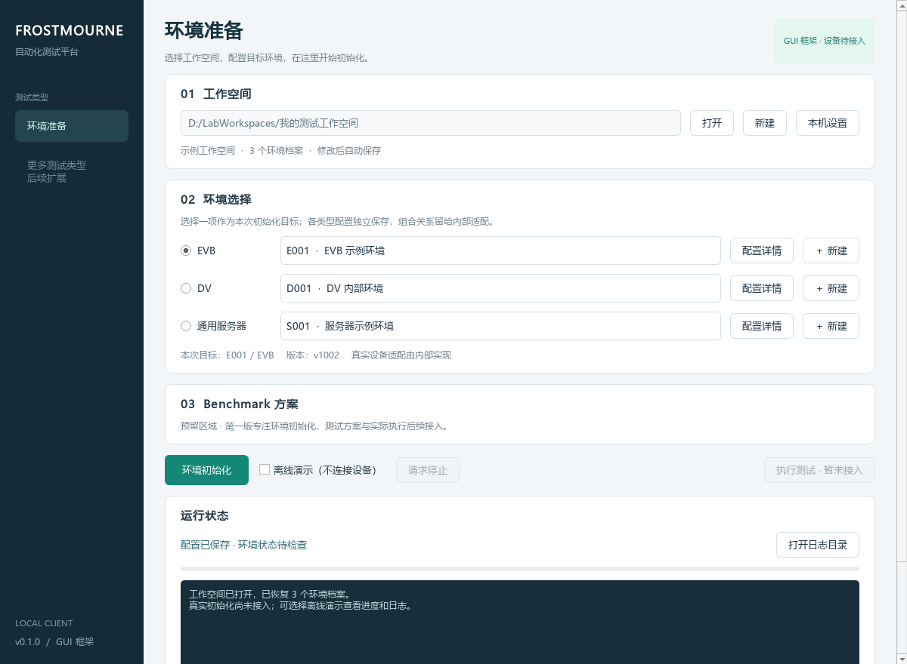

# Frostmourne · 自动化测试客户端

一个面向 Windows 的 Python / PySide6 客户端框架，用本地工作空间保存环境配置，在同一界面完成环境选择、初始化和过程查看。

**当前版本 v0.1.0：可运行的 GUI 与配置框架。真实 EVB、DV、服务器初始化尚未接入。**



## 已实现

- 按用户草图组织的主界面：工作空间、环境选择、Benchmark 预留区、初始化与测试按钮、状态和日志。
- 创建/打开工作空间，记住上次路径，保存与恢复各类型环境档案和最近选择。
- EVB、DV、通用服务器的环境详情编辑；连接信息、版本标识、凭据引用、JSON 扩展参数。
- 本机固件目录、FTP 目录、启动脚本和 Python 路径的配置保存。
- 原子保存、配置格式校验、重复编号检查、检测其他窗口修改，避免静默覆盖。
- 后台运行与进度信号、请求停止、配置快照、日志及 JSON 结果记录。
- 明确的离线演示：不连接设备、不复制固件、不执行脚本；结束后仍不标记环境已就绪。
- 内部环境适配接口。未注册适配器时，真实初始化报告“尚未接入”，不返回假成功。

Benchmark 和“执行测试”保留入口并禁用。未来接入测试时，环境未就绪应提示用户先初始化，不自动烧录或重启。

## 启动

使用 Windows 的 Python 3.10 或更新版本；本地验证版本为 Python 3.12。项目只需要 Qt Essentials，不依赖浏览器或服务器。

在仓库目录中执行：

```powershell
py -3 -m venv .venv
.\.venv\Scripts\python.exe -m pip install -r requirements.txt
.\.venv\Scripts\python.exe -m frostmourne
```

安装依赖后也可以双击 **launch.bat**。不需要激活虚拟环境。

可选：指定一个已经创建过的工作空间，或单独的客户端偏好目录：

```powershell
.\.venv\Scripts\python.exe -m frostmourne --workspace D:\LabWorkspaces\example
.\.venv\Scripts\python.exe -m frostmourne --state-dir .local\state
```

也可执行 `python -m pip install -e .`，使用 `frostmourne` 桌面入口。当前交付源码及启动脚本，尚未提供独立 EXE 安装包。

## 第一次使用

1. 点击顶部“新建”，选择一个本地目录。已有工作空间用“打开”。
2. 在 EVB、DV 或服务器一行点击“＋ 新建”，填写编号和名称，保存环境档案。
3. 需要时在“配置详情”设置版本与连接信息；在“本机设置”配置本地路径。
4. 左侧单选按钮明确本次初始化目标。骨架每次执行一个目标；多环境协作由内部适配扩展，不推断 DV 的含义。
5. 勾选“离线演示”，点击“环境初始化”，观察进度和日志。演示只验证客户端链路。
6. 不勾选演示时，未实现的设备类型会明确提示尚未接入。

关闭后再次打开会恢复配置；不会自动操作设备，也不会沿用上次的就绪状态。执行过程中不能切换工作空间、修改配置或重复启动。

## 本地数据

```text
用户选择的目录/
├── workspace.json          环境档案、最近选择、本机设置（schema_version = 1）
├── .run.lock               运行期间或设备状态未知时的保护记录
└── runs/<运行编号>/
    ├── snapshot.json       本次配置快照（敏感键脱敏）
    ├── execution.log       执行日志
    └── result.json         演示/阻塞/成功/失败等结果
```

为了减少文件协调，本实现将配置统一保存在一个 workspace.json 中；与设计文档中的多目录示意等价，未来可迁移。环境配置没有密码字段，请使用 credential_ref。扩展 JSON 也不要填密码或密钥。

工作空间不是项目源码，建议放在仓库外。本仓库忽略本地工作空间和运行日志；不要强制提交真实环境配置。敏感键脱敏只是诊断辅助，适配器仍须保证日志不含凭据。

若程序异常退出留下 .run.lock，先确认没有其他客户端运行，也没有设备操作仍在进行，再由内部人员人工处理。程序不会自动解除未知状态并重试。

## 内部接入

从 [docs/development.md](docs/development.md) 了解代码结构与 Adapter 接口。现有设备脚本应由内部实现封装，注册到 frostmourne/adapters.py 的 ADAPTERS 中；不能从工作空间动态导入任意 Python 文件。

DV 保留通用扩展字段，具体定义完全留给内部系统。服务器固件更新不属于当前设计范围。

## 验证

```powershell
.\.venv\Scripts\python.exe -m unittest discover -s tests -v
.\.venv\Scripts\python.exe scripts\render_preview.py
```

测试覆盖持久化、配置冲突、数据校验、演示/真实操作隔离、取消、未知设备状态保留锁，以及 Qt 控件与后台线程集成。GUI 测试以 offscreen 模式运行，不操作真实设备。仓库包含 Windows CI 工作流。

## 设计与讨论归档

| 文档 | 内容 |
| --- | --- |
| [design.md](design.md) | 当前客户端架构与使用流程 |
| [work_plan.md](work_plan.md) | 三块工作：客户端、环境初始化、整合交付 |
| [internal_integration.md](internal_integration.md) | 私有操作的内部对接索引 |
| [requirement.md](requirement.md) | 用户最初的需求 |
| [discuss.md](discuss.md) | 多轮讨论的结构化记录，保留用户在文件中的原始回答 |
| [docs/conversation.md](docs/conversation.md) | 会话整理说明及代码实现阶段的补充记录 |
| [界面草图](assets/client-layout-reference.png) | 用户提供的原始布局参考 |

归档是整理后的讨论记录，并非聊天平台的逐字完整导出；不包含系统提示、凭据或工具原始输出。

GUI 基于 Qt 官方 [Qt for Python](https://doc.qt.io/qtforpython-6/gettingstarted.html) 与 [QThread](https://doc.qt.io/qtforpython-6/PySide6/QtCore/QThread.html) 文档实现。
