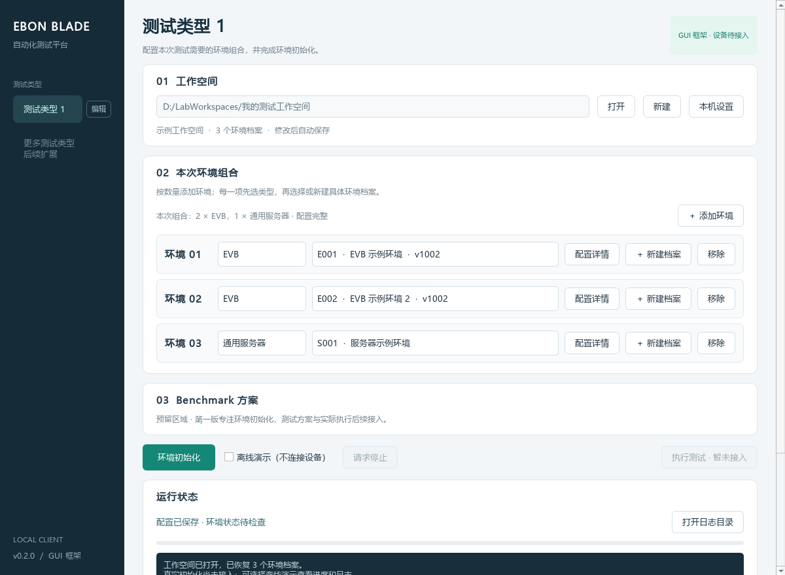

# Ebon Blade · 自动化测试客户端

> **文档定位**：项目首页与公开概览。
>
> **主要作用**：介绍产品目标、当前能力、顶层结构和主要文档入口。
>
> **使用方式**：首次了解或获取项目时从本文开始；具体实现约束继续阅读链接的设计文档。

Ebon Blade 是一个运行在 Windows 上的实验环境自动化客户端。它以本地工作空间保存环境档案和测试组合，在同一界面完成环境编排、初始化、进度查看与日志留存。

项目名取意于《魔兽世界》的黑锋骑士团（Knights of the Ebon Blade）：这支力量专门替巫妖王承担艰难、危险且不那么体面的任务。对本项目而言，Ebon Blade 代表把重复、耗时、易错的环境准备工作交给自动化工具，让测试人员把精力留给真正需要判断的事情。

> 当前版本：v0.2.0。GUI、工作空间和多环境编排框架已经可运行；真实 EVB、DV、服务器初始化仍需接入内部实现。



## 当前能力

- 当前提供一个稳定的测试类型标识，显示名称可在侧栏通过“编辑”按钮按工作空间修改；保留后续多测试类型扩展位置。
- 本次任务可按数量组合环境，例如 `2 × EVB + 1 × 通用服务器`。
- 环境档案与本次组合分开保存，同一档案可跨任务复用。
- 支持创建和打开工作空间、保存本机路径、编辑环境详情。
- 初始化在后台运行，提供进度、日志、停止请求、配置快照和结果记录。
- 离线演示不会连接设备、复制固件或执行脚本，也不会伪装成真实初始化成功。
- Benchmark 与“执行测试”目前只保留入口，第一版聚焦环境初始化。

## 软件架构

Ebon Blade采用单机桌面客户端架构。UI不直接执行设备命令，而是把一次测试需要的环境组合交给运行编排层；环境控制服务选择对应的Environment Driver，由Driver构建Plan，再由公共Executor执行Step并调用Connector。

```text
Qt 桌面界面
    │
    ├── 工作空间与环境组合 ── JSON 持久化、迁移、冲突检查
    │
    └── 初始化任务 ── 快照、日志、进度、停止和结果
                         │
                         └── EnvironmentControlService
                               └── EnvironmentDriver
                                     └── Plan → Phase → Step
                                           └── SSH / Serial / BMC Connector
```

公共框架维护执行、安全和连接规则；具体Driver维护某类环境的配置校验、步骤计划和Ready条件。内部真实映射、命令和Matcher直接放在对应Driver目录的`*_internal.py`中。工作空间不能指定任意Python模块或命令。

详细设计见[系统设计](design/system_design.md)，当前进度见[项目路线](design/project_roadmap.md)。GUI目前仍保留早期同步Adapter入口，桥接到Environment Driver属于下一阶段工作。

## 文件组织

```text
ebon_blade/
├── src/ebon_blade/              GUI、工作空间和产品运行入口
│   ├── __main__.py              程序入口
│   ├── ui.py                    Qt 主界面和配置弹窗
│   ├── models.py                工作空间、环境档案和组合模型
│   ├── storage.py               本地持久化与冲突保护
│   ├── runner.py                初始化任务编排、日志和结果
│   ├── adapters.py              过渡期旧Adapter入口
│   └── ui_design.md             UI模块设计
├── src/env_driver/              环境Driver Core和具体Driver
├── src/basic_connector/         SSH、串口、BMC等基础连接器
├── design/                      系统级和跨模块设计
│   ├── system_design.md         系统设计入口
│   ├── code_ownership.md        内外维护边界
│   └── decisions/               已确认架构决策
├── talk/                        按日期保存的AI讨论与阶段摘要
├── tests/                       核心逻辑与 Qt 离屏测试
├── tools/                       开发辅助脚本
├── AGENTS.md                    AI阅读和开发入口
├── HOW_TO_USE.md                使用、开发和内部接入指南
├── launch.bat                   Windows 快速启动脚本
├── pyproject.toml               Python 项目与桌面入口配置
└── requirements.txt             运行依赖
```

`talk`保存人与AI的讨论和需求演进，不作为当前设计依据。模块设计与具体实现设计就近放在对应源码目录，阅读顺序见[AGENTS.md](AGENTS.md)。

## 开始使用

安装与启动、工作空间操作、离线演示、开发环境、测试方法和 Adapter 接入说明统一放在 [HOW_TO_USE.md](HOW_TO_USE.md)。最短启动方式如下：

```powershell
py -3 -m venv .venv
.\.venv\Scripts\python.exe -m pip install -r requirements.txt
launch.bat
```

当前源码也支持安装为开发包后运行 `ebon-blade` 命令。真实设备接入前，建议始终勾选“离线演示”。

## 文档入口

| 文档 | 用途 |
| --- | --- |
| [HOW_TO_USE.md](HOW_TO_USE.md) | 软件使用、开发、测试与 Adapter 接入 |
| [design/system_design.md](design/system_design.md) | 系统架构、模块关系和依赖方向 |
| [src/ebon_blade/ui_design.md](src/ebon_blade/ui_design.md) | UI和工作空间设计 |
| [src/env_driver/env_driver_design.md](src/env_driver/env_driver_design.md) | Environment Driver模块设计 |
| [src/env_driver/evb/evb_driver_design.md](src/env_driver/evb/evb_driver_design.md) | EVB Driver具体设计 |
| [src/basic_connector/basic_connector_design.md](src/basic_connector/basic_connector_design.md) | 基础连接器设计入口 |
| [design/project_roadmap.md](design/project_roadmap.md) | 当前状态和后续路线 |
| [design/code_ownership.md](design/code_ownership.md) | 外部、协作和内部文件边界 |
| [design/requirements.md](design/requirements.md) | 用户最初的需求记录 |
| [talk/summaries/project_status.md](talk/summaries/project_status.md) | 当前阶段摘要 |

工作空间和运行日志属于本地运行数据，不应提交到代码仓库。环境配置只保存凭据引用，不应写入密码、密钥或其他敏感信息。
