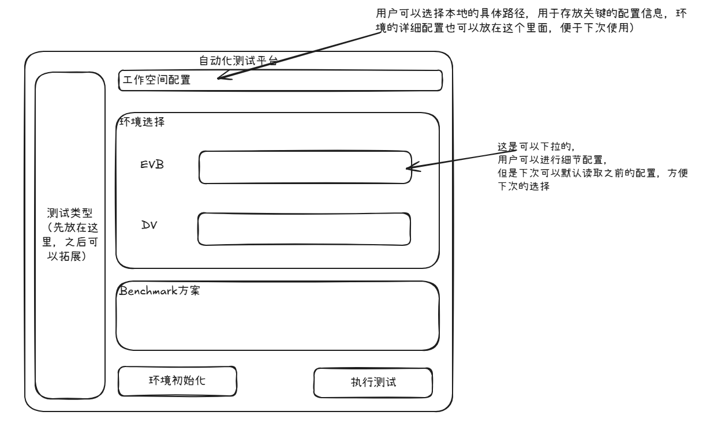

# 自动化测试平台架构设计

版本：v0.2｜日期：2026-10-24｜状态：按客户端草图修订，供评审

实现进度：现已提供 v0.2.0 GUI 骨架，使用 Python / PySide6。工作空间、可增删的多环境组合、配置编辑和演示已实现；真实设备初始化尚未接入。运行与代码说明见 [README.md](README.md)。本文仍描述目标设计，不能视作全部实现完成。

本文说明用户看到的软件及其内部组织。实施计划见 [work_plan.md](work_plan.md)，设备私有信息的对接要求见 [internal_integration.md](internal_integration.md)。

## 1. 产品定义与第一版范围

这是一个运行在个人 Windows PC 上的客户端软件。用户在一个窗口里选择工作空间、选择并配置环境、保存设置，然后点击“环境初始化”。程序负责调用已有能力完成准备，显示进度、结果和日志。

此前“配置工具 + 执行工具”调整为同一客户端内的配置功能与执行功能。内部仍分模块，用户日常无需导出配置再启动另一个程序。配置文件作为保存和复用设置的方式，由客户端管理；导入导出可以作为辅助能力。

**第一版完成环境初始化。** Benchmark 方案区和“执行测试”按钮保留入口，明确提示暂未接入。后续接入测试时，环境未就绪应提示先点击“环境初始化”，不自动初始化、烧录或重启。

| 内容 | 已确认的要求 |
| --- | --- |
| 工作空间 | 用户选择本地目录，保存配置和环境详情，下次打开可继续使用 |
| 环境配置 | 按数量添加环境槽位，每个槽位选择类型和已保存档案，可打开详情编辑 |
| EVB 初始化 | 选择版本、准备文件、检查目标、调用已有脚本烧录并启动 OS、串口配置网卡、SSH 部署软件及初始化 |
| 通用服务器初始化 | BMC 上下电/重启、BIOS 参数修改、SSH 部署驱动和第三方软件、执行初始化 |
| DV | 作为一种特殊环境保留配置和初始化接入位置，细节完全由内部实现 |
| 过程反馈 | 显示当前动作、日志与最终结果；失败时停止后续操作并保留现场 |
| 扩展位置 | 左侧测试类型、Benchmark 方案和执行测试入口，后续扩展 |

DV 按特殊环境处理，不预设为通用服务器。它与其他环境是否联用、需要哪些输入，由内部定义；本文不设定“必须二选一”或“必须同时选择”。

第一版不包括实际 Benchmark 执行、自动修复、无人值守调度、跨 PC 环境占用管理，以及服务器 BIOS/BMC 或待测板卡固件更新。仅更换测试参数不会自动触发环境重新准备。

## 2. 客户端界面

以下草图由用户提供，作为本次设计的布局依据：

第二轮修改依据保存在 [界面批注图](assets/client-layout-feedback-v2.png)，其核心是把左侧区域明确为可扩展的测试类型，并把单选环境改为可增删的环境组合。

| 区域 | 使用方式 |
| --- | --- |
| 顶部工作空间 | 选择或打开本地目录；显示当前路径，载入该空间上次保存的设置 |
| 左侧测试类型 | 当前显示“测试类型 1”；后续测试类型可变更、增加 |
| 中部环境组合 | 动态增删环境槽位；每项选择类型和具体档案，允许同一类型出现多次 |
| 环境详情 | 编辑对应环境的连接、版本和初始化参数，保存后回到主界面 |
| Benchmark 方案 | 首版显示预留区域与“暂未接入”，后续放方案选择和参数配置 |
| 环境初始化 | 检查当前配置，保存本次配置快照，运行初始化并显示过程 |
| 执行测试 | 首版保留但禁用，并说明原因；接入后先检查环境是否就绪 |
| 状态与日志 | 建议在现有主界面增加可展开的区域，显示进度、失败位置和“打开日志目录” |

最后一项是对草图的补充建议，用于解决启动耗时较长、需要观察日志的问题，不要求增加复杂页面。

环境档案只展示该类型适用的字段。EVB 中可以配置版本、BMC、串口和启动框架参数；服务器中展示电源、BIOS 和 SSH 等参数；DV 的字段由内部定义。档案与本次组合分开保存：E001 可被多次测试复用，本次组合可以是 E001 + E002 + S001。同一物理档案不能在同一组合中重复选择，以免误操作同一设备。

第一版主界面不要求直接展示 5 个串口的私有用途；详细信息在内部配置表单和环境适配中维护。

## 3. 用户怎样使用

### 首次使用

1. 启动客户端，选择一个本地目录作为工作空间。
2. 新建或导入环境档案，填写当前 PC 的脚本位置、FTP 路径等本地设置。
3. 按数量添加本次所需环境，逐项选择类型和具体档案，进入详情补齐必要参数并保存。
4. 点击“环境初始化”，在同一窗口查看过程与结果。

### 再次使用

客户端可记住上次的工作空间路径。打开该空间后，恢复环境档案、本次组合及已保存参数。用户只修改本次有变化的内容，然后初始化环境。

**恢复配置不等于恢复设备就绪状态。** 上次记录的“准备成功”是历史结果，不能保证当前设备仍未被他人改变。客户端重新打开后应显示“待检查”或历史结果的时间，运行前按适配规则检查。

### 运行过程中

初始化在后台任务中执行，窗口应保持可响应，用户能查看日志。首版建议同一客户端同时只执行一个初始化任务；执行期间不允许切换工作空间或修改本次生效配置，也不能重复点击启动另一个任务。

失败时显示发生在哪一步、相关日志位置，以及是否仍有设备动作在进行。人工处理后，用户明确决定是否再次初始化，程序不自行重烧或重启。

## 4. 工作空间与配置保存

工作空间是本客户端的日常使用单位。它保存配置和运行记录，不要求把所有固件或 Python 运行环境都复制进去。

建议结构如下，名称和文件格式可在内部实施时调整：

~~~text
用户选择的工作空间/
├── workspace.json       工作空间信息、上次选择
├── environments/        各环境的详细配置
├── settings/            当前 PC 的本地设置、版本来源引用
├── benchmarks/          后续 Benchmark 方案的预留位置
└── runs/                每次初始化的配置快照、日志与结果
~~~

这些文件由客户端读写，用户不需要日常手工拼装任务文件。保存要避免产生半份配置；读取不兼容或损坏的文件时，应给出明确提示，不静默重置用户设置。

| 配置信息 | 说明 |
| --- | --- |
| 环境身份与连接 | 编号、环境类型、预期身份、BMC/SSH/串口地址、内部适配引用 |
| 本地设置 | 启动框架位置、Python 和依赖引用、FTP 服务目录、可被设备访问的服务地址 |
| 版本选择 | 固件、驱动与第三方包的引用；版本可以是正式版本或个人特殊编译 |
| 本次组合 | 测试类型及按顺序排列的环境槽位，每项引用一个环境档案 |
| 运行快照 | 点击初始化时实际使用的配置、文件校验值、日志与结果，不随之后编辑改变 |

凭据使用内部定义的引用方式，不把密码和密钥直接写入普通配置或日志。

原有 Excel 或集中的环境清单可以作为导入、更新来源；首版不以建设中心配置服务为前提。应记录来源或修订信息，更新地址时展示差异，再保存到当前工作空间并重新核验。后续是否实现自动同步另行评估。

工作空间被复制到另一台 PC 后，脚本路径、网络地址和凭据引用可能不同，需要检查本机设置。打开已有工作空间时也不自动执行其中的设备操作。

## 5. 内部架构

~~~mermaid
flowchart TD
    UI[客户端主界面] --> Workspace[工作空间与配置管理]
    UI --> Actions[初始化与测试操作入口]
    Workspace --> Actions
    Actions --> Runner[后台执行与状态管理]
    Runner --> Env[环境适配]
    Env --> EVB[EVB]
    Env --> Server[通用服务器]
    Env --> DV[DV：内部实现]
    EVB --> Tools[已有脚本、文件准备、SSH、串口]
    Server --> Tools
    DV --> Tools
    Actions -. 后续接入 .-> Bench[Benchmark 执行]
    Runner --> Records[日志与运行结果]
    Records --> UI
~~~

交付物是一个客户端项目。内部采用 Python 作为自动化基础，GUI 的具体库在实现时选定。后台执行可由线程或子进程承载，关键是耗时操作不阻塞界面，并能持续回传状态；不要求建设网络服务或中心调度平台。

内部模块只用于维护职责，不分别成为开发里程碑：

| 模块 | 职责 |
| --- | --- |
| 客户端界面 | 布局、环境详情编辑、按钮、状态与日志展示 |
| 工作空间管理 | 选择目录、保存和恢复配置、格式校验、维护运行记录 |
| 执行控制 | 接收当前配置快照，检查、调度、等待和汇总，不自行猜测设备命令 |
| 环境适配 | 将 EVB、服务器、DV 的私有流程封装为可调用的初始化能力 |
| 通用操作 | SSH/SFTP、串口连接、文件准备、脚本调用和日志采集 |

初始化入口接收“环境组合、版本、参数、本地设置”，先检查所有目标所需能力，再依次初始化并持续返回进度和日志，最后返回组合结果。缺少任何必要适配器时，本次任务在设备操作前整体停止，避免产生部分初始化。内部可以保留独立调用接口，以便将来接入自动化或 AI；首版不要求用户使用命令行。

如果某个环境方案需要多个目标，内部适配定义其配置和执行关系；公共界面和执行层不硬编码 EVB/DV 之间的关系。

## 6. 环境初始化

### EVB

用户点击一次“环境初始化”，客户端依次完成：

**配置及文件检查 → 文件准备 → 目标核验 → 调用已有脚本启动 → 串口配置网卡 → SSH 部署与初始化 → 最终就绪检查。**

固件有既定命名规则，不增加本地解压步骤。烧录和 OS 启动复用已有脚本；程序要传入本次有效配置，避免脚本从其他旧文件读取不同的目标。

建议首版沿用本地版本目录和 FileZilla，准备到服务目录后调用启动流程。这是尚可调整的实施建议，不是用户已确认的固件部署选择。中心固件仓库以后可以通过“获取到本地”的方式接入，不改变主界面的操作。

### 通用服务器

**检查目标 → 按配置进行电源/BIOS 参数操作及必要重启 → 等待 OS 与 SSH → 软件部署及初始化 → 最终检查。**

具体顺序由内部设备实现决定。BIOS 参数更新必须确认实际生效，不等同于请求返回成功。Redfish 为候选控制接口，能力与鉴权在内部验证。

### DV

提供同样的配置、初始化、进度、结果接口。实际端点、前置条件、动作和成功条件均由内部补齐。尚未接好时显示“此环境初始化尚未配置”，不能默认套用 EVB 或服务器流程，也不能返回模拟成功。

### 必须保留的检查

- 通过环境编号选择目标，执行前核对实际设备身份；预期 BMC MAC 来自已核对的档案，不从当前连接读取后自动登记为正确值。
- BMC 身份正确不代表所有串口也正确，具体关联依据由内部处理，不仅凭 MAC 尾部判断。
- 相关控制路径未完成必要核验时不进入烧录或复位等动作。
- 本次启动日志、初始化结果和最终就绪状态分别检查，不能仅根据脚本退出或 SSH 可连报告全部成功。
- 初始文件、日志和配置属于本次运行；文件被使用期间不允许其他本地任务覆盖。

检查规则保留在内部适配中，不把它们变成用户每天必须手工完成的一串表单。

## 7. 两个按钮的行为与失败处理

| 操作或状态 | 客户端行为 |
| --- | --- |
| 点击环境初始化 | 校验当前配置，保存运行快照，开始后台初始化 |
| 初始化正在运行 | 持续显示进度和日志，阻止重复启动及相关配置修改 |
| 初始化成功 | 显示“环境已就绪”，记录目标、版本、时间和检查依据 |
| 初始化失败/超时 | 停止后续步骤，保存日志，说明设备动作是否可能仍在进行 |
| 首版执行测试 | 保留入口但禁用，标注“暂未接入” |
| 后续执行测试但环境未就绪 | 检查并提示先点击“环境初始化”，不自动准备 |
| 后续执行测试且就绪检查通过 | 按 Benchmark 方案执行；换参数本身不触发环境重启 |

如果修改目标、固件或会影响准备结果的参数，应使原有“已就绪”标记失效。单纯改变 Benchmark 测试参数不自动重新初始化。哪些私有参数影响就绪由内部适配声明。

超时、PC 程序退出或取消不等于远端动作停止。首版不自动重放烧录、重启、安装等动作。若提供停止按钮，须区分停止后续步骤与终止当前动作；当前操作不可中断时，应显示明确状态并继续按内部规则处理。

首版不实现跨 PC 环境占用机制，仍需人工协调环境使用；本机的任务、FTP 目录和会话需要必要的互斥。

## 8. 内部对接与后续扩展

[internal_integration.md](internal_integration.md) 继续保存需要内部实现的信息。它是参考清单，不是要求用户逐项追踪的项目计划。

| 内部项 | 对应内容 |
| --- | --- |
| INT-001 | 工作空间内的环境配置、本地设置及环境清单来源 |
| INT-002～003 | 身份核验与串口关联 |
| INT-004～006 | 文件准备、既有启动脚本及启动判定 |
| INT-007～008 | 网卡、SSH、软件部署和最终就绪 |
| INT-009～011 | 服务器控制、跳板连接、异常与现场保留 |
| INT-012 | DV 的内部配置与初始化接入，不公开其含义 |

第一版之后再接入 Benchmark，逐步扩展测试类型、监控、结果分析、环境占用和无人值守。AI 推荐或执行也调用同一套能力，不单独建立绕开检查的操作流程。

本文已按一个客户端的产品形态整理。GUI 骨架已开始实现；环境适配仍需内部补齐。当前实现将环境与设置集中保存到 workspace.json，目录布局是设计示意，具体行为见 README。
