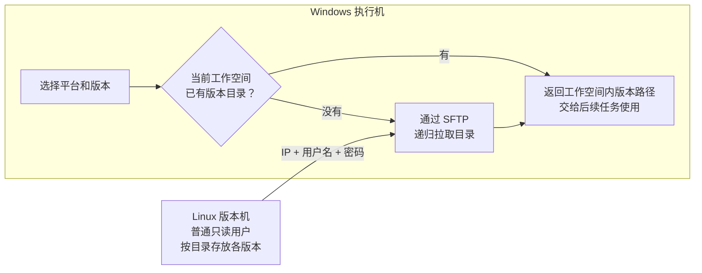

# 简单二进制版本目录设计

状态：第一期设计已确认

最近更新：2026-10-27

## 1. 设计目标

第一期不建设专门的制品仓库，也不部署FTP服务、数据库、网页、Manifest或校验系统。

只准备一台普通Linux主机，使用系统已有的SSH/SFTP能力保存版本目录。Windows执行机输入服务器IP、普通用户名和密码，通过SFTP把需要的版本直接拉到当前工作空间下的`versions/`目录。若当前工作空间中已经存在该版本目录，就直接使用，不再访问服务器。

## 2. 概念架构



整个第一期只有一句话：**当前工作空间中有就直接用，没有就从Linux通过SFTP拉到工作空间中。**

## 3. 为什么使用SFTP

- Linux一般已经运行SSH服务，不需要另外安装FileZilla或FTP服务器。
- 普通用户即可读取版本目录，不需要root权限或sudo。
- 项目现有SSH Connector已经具备SFTP下载能力，可以直接复用。
- 连接、密码传输和文件传输都走SSH，不再实现一套FTP Connector。

如果Linux机器尚未启用SSH服务，仍需要管理员一次性启用OpenSSH；平台本身不负责修改Linux系统配置。

## 4. Linux目录

建议只保留“平台/版本/文件”三层概念：

```text
/data/ebon_versions/
├── chip-x-evb/
│   ├── v1001/
│   │   ├── 固件.zip
│   │   ├── 驱动.zip
│   │   └── 第三方包.zip
│   ├── v1002/
│   │   ├── 固件.zip
│   │   ├── 驱动.zip
│   │   └── 第三方包.zip
│   └── personal/
│       └── zhangsan/
│           └── add_latency_based_on_v1002/
│               ├── 固件.zip
│               ├── 驱动.zip
│               └── 第三方包.zip
└── chip-y-evb/
    └── ...
```

平台通过SFTP列目录获得可选版本，不需要`catalog.json`。正式版本和个人版本只是不同的目录路径，程序不赋予更多发布语义。

建议约定版本目录创建完成后不再修改。如果确实修改了远端同名目录，用户需要在Windows端手动执行“重新拉取”；第一期不自动比较远端与本地内容。

## 5. Linux账号

建议创建普通账号，例如`ebon_reader`：

- 无sudo权限。
- 只需要读取`/data/ebon_versions`。
- 不需要读取其他项目或用户目录。
- 第一阶段可以使用用户名和密码登录。

连接界面需要：

```text
服务器IP
SSH端口（默认22）
用户名
密码
远端版本根目录
```

IP、端口、用户名和远端目录可以保存；本地目录固定为当前工作空间的`versions/`，无需配置。密码使用界面中的密码输入框，在软件启动后首次需要连接时输入，不写入工作空间JSON和普通日志。以后如果嫌每次输入麻烦，再接Windows凭据管理器。

SSH主机身份校验继续使用现有SSH Connector策略，不在版本模块重复实现。

## 6. Windows本地镜像

每个工作空间保存自己的版本缓存。本地根目录固定为：

```text
<workspace>/versions/
```

其下尽量与Linux保持相同结构：

```text
<workspace>/versions/
├── chip-x-evb/
│   ├── v1001/...
│   ├── v1002/...
│   └── personal/zhangsan/add_latency_based_on_v1002/...
└── chip-y-evb/...
```

本地命中规则非常简单：当前工作空间的目标版本目录存在，就认为可用，不再连接Linux，也不检查其他工作空间是否缓存过该版本。

为了避免网络中断后把半份目录当成完整版本，下载时只增加一个最小保护：

```text
先下载到 v1002.downloading
→ SFTP递归下载正常结束
→ 改名为 v1002
```

这不是内容校验，也不计算SHA-256，只用于区分“下载完成”和“下载中断”。中断遗留的`.downloading`目录下次可以清理后重新拉取。

## 7. 最小软件接口

第一期不需要`ArtifactRepository`、`ArtifactCache`和`ArtifactMaterializer`三层抽象，只保留一个简单服务：

```python
class SimpleVersionStore:
    async def list_platforms(self) -> tuple[str, ...]: ...

    async def list_versions(self, platform: str) -> tuple[str, ...]: ...

    async def ensure_local(
        self,
        platform: str,
        version: str,
    ) -> Path:
        """本地存在则直接返回；否则通过SFTP下载后返回。"""
```

内部直接复用：

```text
ManagedSSHSession.connect()
ManagedSSHSession.download()
ManagedSSHSession.close()
```

一次列目录或下载任务创建一次SSH会话，完成后关闭；不维护全局永久连接。

## 8. 使用流程

```text
用户配置Linux版本机连接
→ 平台通过SFTP列出平台和版本目录
→ 用户选择例如 chip-x-evb / v1002
→ ensure_local()检查<workspace>/versions/chip-x-evb/v1002
→ 已存在：直接返回本地路径
→ 不存在：递归下载到.downloading目录，完成后改名
→ 后续启动脚本、FileZilla准备步骤或Environment Model使用该本地路径
```

版本模块只负责得到一个可用的本地目录。后续任务是直接读取该目录，还是再复制到本机FileZilla服务目录，由对应Environment Model决定，不放进第一期版本模块。

## 9. 第一阶段不做的事情

- 不做FTP协议和FTP服务器。
- 不做Manifest、Catalog和数据库。
- 不计算SHA-256，不比较远端和本地文件差异。
- 不做版本审批、发布页面和不可变版本强制检查。
- 不做自动缓存淘汰、磁盘配额和跨机器共享缓存。
- 不做多源仓库和复杂组合版本。
- 不做断点续传；失败后清理临时目录并重新下载即可。

## 10. 最少错误处理

只区分用户真正需要看到的几种情况：

- IP不可达或SSH端口不可达。
- 用户名或密码错误。
- 远端根目录、平台或版本不存在。
- 本地目录不可写或磁盘空间不足。
- 下载中断。
- 同一个版本正在被另一个任务下载。

任何下载失败都不能生成最终版本目录；已经存在的其他本地版本不受影响。

## 11. 已确认决策

1. Linux目录按“平台/版本/文件”组织；固件、驱动和第三方包先放在同一个版本目录中。
2. 密码在软件启动后首次连接时输入，不保存到工作空间。
3. 本地缓存固定放在当前工作空间的`versions/`目录中，不提供额外的本地缓存路径配置。
4. 当前工作空间中存在同名版本目录就直接使用，不自动检查远端变化；需要更新时由用户手动执行“重新拉取”。
5. 第一阶段版本模块只返回工作空间内的本地版本路径，不处理FileZilla目录复制。
