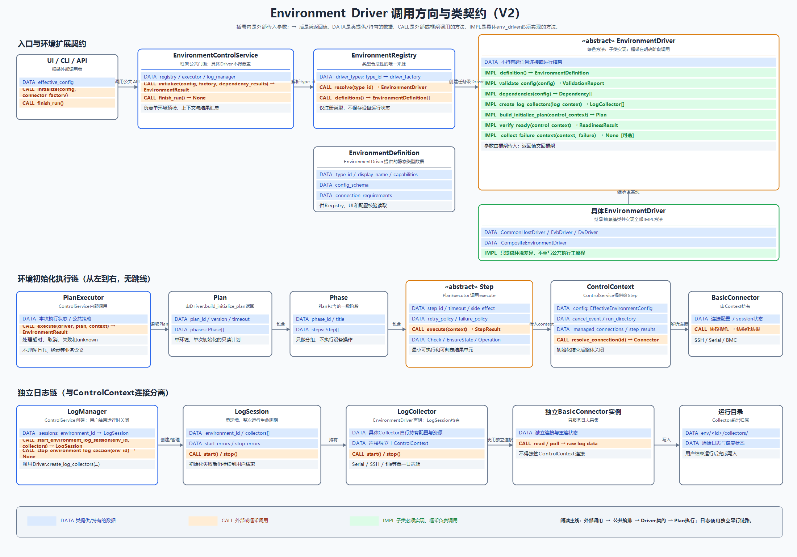
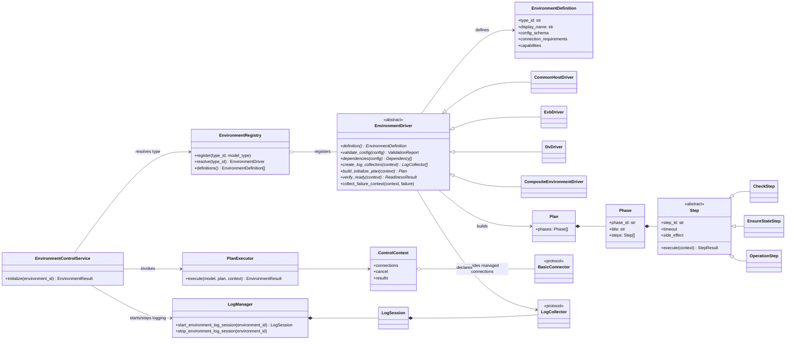

# Environment Driver模块设计

> **文档定位**：Environment Driver模块权威设计。
>
> **主要作用**：定义Driver接口、Core执行链、配置、Plan/Step、依赖和日志生命周期。
>
> **使用方式**：修改`env_driver/core`或新增具体Driver前必须阅读，再进入下层Driver设计。

状态：当前有效，公共框架第一版已实现

层级：模块设计

上层设计：[系统设计](../../design/system_design.md)

相关代码：`src/env_driver/`

最后复核：2026-10-28

## 1. 顶层职责

环境控制分为四类对象，避免一个`initialize()`同时承担参数、步骤、连接和日志生命周期：

```text
EnvironmentDefinition：参数Schema、UI元数据、能力和版本
EnvironmentDriver：环境专属Python实现，生成步骤并调用Connector
PlanExecutor：框架公共执行器，强制步骤状态、异常、取消和结果规则
LogSession：独立日志观察会话，从环境初始化前持续到全部测试结束
```

环境控制Connector只在初始化或其他控制动作期间打开，动作结束后关闭。只有被环境声明为日志采集器的连接才由`LogSession`继续持有；控制连接和观察连接不得因为底层协议相同就混为一个生命周期。

### 1.1 第一版代码边界

当前已实现注册、配置值对象、抽象Driver、Plan/Phase/三类Step、单环境执行、步骤与Plan超时、取消/unknown传播、依赖结果阻塞、ControlContext资源回收，以及与控制连接分离的LogSession生命周期。

当前`EnvironmentControlService.initialize()`一次只执行一个环境；调用方传入已经完成的`dependency_results`。多环境拓扑排序、缺失引用/循环依赖的整批预检与顺序调度仍属于下一层Run Orchestrator，不应误认为已由当前单环境Service实现。`EnvironmentDefinition.config_schema`目前作为元数据保存，具体语义仍由`validate_config()`执行；以后确定统一Schema格式后再增加公共Schema解释器。

## 2. 本次运行参数YAML模板

当前环境控制框架只接收本次运行已经确定的生效配置。长期环境档案、版本管理和覆盖逻辑由后续环境管理模块负责，不在本模块设计。以下是完整模板，不表示每种环境必须使用所有字段：

```yaml
schema_version: 1

environment:
  id: server-001                 # 必填，工作空间内稳定且唯一
  type: common_host              # 必填，必须存在于EnvironmentRegistry
  name: 通用服务器01             # 必填，人类可读名称
  description: ""               # 可选
  tags: [lab-a, x86]             # 可选，筛选用途

identity:
  expected_machine_id: ""       # 可选，内部定义的设备身份
  expected_bmc_id: ""           # 可选，例如脱敏后的预期标识

connections:                     # 以稳定connection_id为键，支持多个同类连接
  host_ssh:
    type: ssh
    role: host_control
    enabled: true
    host: 192.0.2.10
    port: 22
    username: tester
    credential_ref: cred/server-001/host-ssh
  jump_ssh:
    type: ssh
    role: jump_host
    enabled: false
    host: 192.0.2.11
    port: 22
    username: tester
    credential_ref: cred/server-001/jump-ssh
  console_1:
    type: serial
    role: serial_console
    enabled: true
    host: 192.0.2.20
    port: 2001
    line_ending: cr
  console_2:
    type: serial
    role: serial_console
    enabled: false
    host: 192.0.2.20
    port: 2002
    line_ending: cr
  management_bmc:
    type: bmc
    role: power_control
    enabled: true
    host: 192.0.2.30
    protocol_preference: [redfish, ssh]
    system_id: System.Embedded.1
    username: admin
    credential_ref: cred/server-001/bmc

initialization:
  profile: default               # 受信任Python实现中的初始化方案名
  firmware_ref: null
  packages: []
  parameters: {}                 # env_driver校验的专属参数

logging:
  collectors:                    # 环境声明需要启动的日志采集器
    - id: primary_serial
      type: serial
      connection: console_1       # 引用connections中的稳定ID
      enabled: true
      start_phase: before_initialize
      stop_phase: after_all_tests
  environment_parameters: {}

dependencies: []                 # 普通物理环境通常为空

ui:
  group: Servers                 # 可选，只影响展示
  order: 10
```

密码、Token和私钥不允许直接写入YAML，只保存`credential_ref`。`ui`只保存简单展示信息；字段标签、类型、必填规则和复杂控件定义属于受信任的`EnvironmentDefinition`，不能完全相信工作空间YAML决定界面与执行行为。框架把收到的配置验证后保存为本次运行快照，不负责与任何长期档案合并。

### 2.1 类型和连接合法性

`environment.type`必须同时在界面和配置加载阶段受限：

- `EnvironmentRegistry`是合法环境类型的唯一事实来源。
- UI下拉框只展示Registry当前已经注册的类型。
- 手工编辑YAML后，加载器仍必须调用Registry校验；未知类型在任何设备操作前拒绝。
- 类型ID使用稳定的小写标识，例如`common_host`、`evb`、`dv`、`composite`。重复注册同一ID属于启动配置错误。

`connections`使用映射而不是固定的`ssh/serial/bmc`单例字段。键是环境内唯一且稳定的`connection_id`；值中的`type`决定使用哪个Basic Connector，`role`表达它在该环境中的用途。同一`type`或`role`都可以出现多次。

`EnvironmentDefinition`应声明连接约束，例如：

```text
host_control:    type=ssh,    min=1, max=1
serial_console: type=serial, min=0, max=5
power_control:  type=bmc,    min=1, max=1
```

公共加载器验证ID唯一、Connector类型存在、字段Schema正确以及Collector引用有效；具体Driver再验证角色数量和环境专属组合是否合法。

## 3. 环境抽象类和公共接口

### 3.1 重点评审位图



第二版不再用大量关系跳线，而是拆成三条从左到右的泳道：入口与环境扩展契约、环境初始化执行链、独立日志链。

- **`DATA`蓝色行**：该类提供或持有的数据/属性，不表示一次函数调用。
- **`CALL`橙色行**：外部、框架或相邻对象会调用的方法；括号内是调用者传入的参数，`→`后是返回值。
- **`IMPL`绿色行**：具体`env_driver`子类必须实现的方法；实现由子类提供，但调用时机仍由公共框架控制。
- 普通灰色行是职责和限制说明，不是属性或方法。

例如：`IMPL validate_config(config) → ValidationReport`表示`config`由框架传给Driver，具体Driver实现校验逻辑，并把`ValidationReport`返回给框架；不是Driver向外提供一个名为`config`的属性。

位图由`tools/render_environment_driver_call_diagram.ps1`生成；类或接口变更后应重新生成，避免图片与下方可维护类图不一致。旧版图片仅保留为设计过程参考，不再作为当前阅读入口。

### 3.2 可维护类图



带`*`的方法是每个具体`EnvironmentDriver`必须实现的接口。`EnvironmentControlService`、`PlanExecutor`和`LogManager`属于框架公共实现，具体Driver只调用或被调用，不能覆盖其主流程。

### 3.3 各类职责与生态位

本节中的“生态位”具体指一个类在系统中的所属层、创建者、生命周期、上下游协作对象，以及它不应该承担的职责。

#### 3.3.1 注册与静态定义层

##### `EnvironmentRegistry`

| 维度 | 说明 |
| --- | --- |
| 设计定位 | 环境类型注册表，也是`environment.type`合法性的唯一事实来源 |
| 所属层 | 应用启动与扩展注册层 |
| 创建者 | 应用Composition Root在启动时创建并完成注册 |
| 生命周期 | 进程级；启动后原则上只读，不在任务运行中随意增删类型 |
| 核心职责 | 注册`type_id -> EnvironmentDriver工厂/类型`；解析YAML中的环境类型；向UI提供可选环境定义 |
| 主要协作 | 上游是应用启动代码；下游是`EnvironmentControlService`和参数界面 |
| 明确禁止 | 不保存具体环境实例、不持有Connector、不执行步骤、不读取设备状态 |

关键函数：

- **`register(type_id, model_type)`**：启动时注册受信任的Driver类型；重复ID必须失败。
- **`resolve(type_id)`**：将配置中的稳定类型ID解析为Driver工厂或类型；未知ID必须在设备操作前失败。
- **`definitions()`**：返回全部静态定义，供UI生成环境类型选择和参数表单。

##### `EnvironmentDefinition`

| 维度 | 说明 |
| --- | --- |
| 设计定位 | 某一种环境类型的不可变元数据和值对象 |
| 所属层 | Schema与能力描述层 |
| 创建者 | 具体`EnvironmentDriver.definition()` |
| 生命周期 | 类型级；同一环境类型可复用，不包含某台设备的运行状态 |
| 核心职责 | 描述类型ID、显示名称、参数Schema、连接角色与数量约束、能力和UI元数据 |
| 主要协作 | 被Registry收集，被配置加载器和UI读取，被Driver语义校验补充 |
| 明确禁止 | 不连接设备、不执行初始化、不保存密码、不包含本次运行产生的状态 |

`EnvironmentDefinition`回答“这种环境允许配置什么”，本次YAML回答“这次具体配置了什么”，两者不能混在一起。

#### 3.3.2 环境扩展层

##### `EnvironmentDriver`

| 维度 | 说明 |
| --- | --- |
| 设计定位 | 所有环境类型的核心抽象基类，也是新增环境的主要扩展入口 |
| 所属层 | 环境业务编排层，位于公共执行器与Basic Connector之间 |
| 创建者 | `EnvironmentControlService`通过Registry解析后，为具体环境创建任务级实例 |
| 生命周期 | 建议任务级或无状态；不得把一次运行的连接和结果保存在进程级单例中 |
| 核心职责 | 校验环境语义、声明依赖与日志采集器、构造初始化Plan、执行最终就绪判断 |
| 主要协作 | 上游由ControlService和PlanExecutor调用；下游通过Step和Context使用Connector |
| 明确禁止 | 不覆盖公共初始化主流程、不在构造Plan时操作设备、不建立全局连接、不直接控制UI |

它是最需要重点评审的基类。一个新环境通常只需实现此基类及其Step，不应该重新实现Registry、Executor或日志生命周期。

六个必实现函数：

| 函数 | 调用时机 | 必须返回/完成 | 关键约束 |
| --- | --- | --- | --- |
| **`definition()`** | 应用启动、表单生成和配置加载时 | 该环境类型的不可变Definition | 纯函数语义，不得访问网络或设备 |
| **`validate_config(config)`** | 公共Schema校验通过后、任何设备操作前 | 环境专属ValidationReport | 一次返回全部可发现问题；不得顺便修复设备 |
| **`dependencies(config)`** | 整体计划预检阶段 | 该环境依赖的环境ID和要求状态 | 只声明依赖；不能自行启动被依赖环境 |
| **`create_log_collectors(context)`** | 环境初始化之前 | 该环境需要的Collector描述或实例 | Collector使用独立连接，所有权交给LogSession |
| **`build_initialize_plan(context)`** | 配置与依赖检查通过后 | 结构完整的Plan/Phase/Step | 只能构造计划，不能在此阶段执行Connector动作 |
| **`verify_ready(context)`** | 初始化Plan完成后 | 独立的ReadinessResult | 不能只复用“最后一步成功”；必须验证最终目标状态 |

可选函数：

- `collect_failure_context(context, failure)`只用于补充有界、只读诊断；采集失败不能覆盖原始失败，也不能在其中自动执行危险恢复。

##### `CommonHostDriver`

| 维度 | 说明 |
| --- | --- |
| 设计定位 | 普通主机/服务器环境的具体Driver |
| 主要职责 | BMC状态与电源初始化、SSH就绪、软件部署、主机最终状态验证 |
| 典型Connector | BMC、SSH、必要时串口 |
| 生态位 | 第一套推荐的参考实现，用来验证公共抽象是否足够 |
| 禁止承担 | 不把厂商BMC命令写进公共Executor；命令应留在受信任Profile或内部实现 |

##### `EvbDriver`

| 维度 | 说明 |
| --- | --- |
| 设计定位 | EVB环境的具体Driver |
| 主要职责 | 固件/文件检查、启动框架调用、烧录与启动、串口网络配置、SSH部署、最终就绪验证 |
| 典型Connector | 本地进程、文件传输、多个串口、SSH，按内部需要使用BMC |
| 生态位 | 复杂硬件启动流程的实现者，验证多连接、长耗时和日志观察能力 |
| 禁止承担 | 不绕过PlanExecutor直接串联全部脚本；不把持续日志连接绑定在ControlSession中 |

##### `DvDriver`

| 维度 | 说明 |
| --- | --- |
| 设计定位 | DV特殊环境的受信任内部Driver |
| 主要职责 | 根据内部协议实现参数校验、初始化步骤、日志采集和就绪判断 |
| 典型Connector | 由内部需求决定，但仍通过ControlContext取得 |
| 生态位 | 保留特殊环境差异，同时证明公共框架不需要理解DV内部含义 |
| 禁止承担 | 未实现时不得套用其他环境逻辑或返回模拟成功 |

##### `CompositeEnvironmentDriver`

| 维度 | 说明 |
| --- | --- |
| 设计定位 | 多个既有环境之间的软件配置与协调Driver，不代表新的物理设备 |
| 主要职责 | 声明依赖、读取依赖环境结果、执行跨环境配置、验证组合关系 |
| 典型Connector | 通常通过依赖环境暴露的受控能力完成协调；自身可有少量软件连接配置 |
| 生态位 | 依赖图中的协调节点；上游环境Ready后才能运行 |
| 禁止承担 | 不复制被依赖Driver的初始化流程，不拥有或伪造被依赖环境的物理身份 |

#### 3.3.3 公共编排与执行层

##### `EnvironmentControlService`

| 维度 | 说明 |
| --- | --- |
| 设计定位 | UI、CLI或未来API调用环境控制能力时面对的应用服务门面 |
| 所属层 | 应用编排层 |
| 创建者 | 应用启动代码；可以是进程级服务，但每次调用创建独立运行上下文 |
| 生命周期 | 服务进程级，单次`initialize()`调用为任务级 |
| 核心职责 | 校验顶层配置、解析Driver、构建依赖图、启动日志会话、创建ControlContext、调用Executor、汇总环境结果 |
| 主要协作 | Registry、LogManager、PlanExecutor以及工作空间运行目录 |
| 明确禁止 | 不实现EVB/Server命令，不直接操作Socket，不替具体Driver判断设备Ready |

关键公共函数：

- **`initialize(environment_id)`**：框架统一入口。任何真实初始化都必须通过它，不能直接从UI调用某个Driver的Step。
- `validate_dependencies()`应在任何设备动作前发现缺失依赖和循环依赖。
- `finish_run()`负责响应用户“结束本次运行”，停止LogSession并完成运行目录；它不同于单个环境初始化结束。

##### `PlanExecutor`

| 维度 | 说明 |
| --- | --- |
| 设计定位 | 与环境类型无关的步骤执行引擎 |
| 所属层 | 公共运行控制层 |
| 创建者 | 由ControlService持有或注入 |
| 生命周期 | 可复用服务；每次`execute()`只操作一个明确的Plan和Context |
| 核心职责 | 顺序执行Phase/Step、处理超时与取消、维护状态机、应用失败策略、确保结果落定 |
| 主要协作 | Plan、ControlContext、EnvironmentDriver的最终核验和失败诊断钩子 |
| 明确禁止 | 不理解“烧录”“上电”等业务含义，不根据日志文本自行发明步骤，不自动重放危险动作 |

核心函数 **`execute(model, plan, context)`** 必须保证：每个开始的Step都有终态；未执行步骤有明确原因；异常不能绕过资源清理；远端结果无法确认时返回`unknown`而非成功。

##### `LogManager`

| 维度 | 说明 |
| --- | --- |
| 设计定位 | 一次运行中所有环境日志会话的公共所有者 |
| 所属层 | 跨初始化与测试的观察控制层 |
| 创建者 | ControlService在创建本次运行时使用 |
| 生命周期 | 本次运行级，从第一个环境初始化前到用户点击“结束本次运行” |
| 核心职责 | 创建环境日志目录、启动/停止LogSession、隔离Collector失败、在结束时关闭所有日志资源 |
| 主要协作 | EnvironmentDriver提供Collector，LogSession持有并运行Collector |
| 明确禁止 | 不复用ControlSession连接，不解释设备日志含义，不因初始化结束自动关闭 |

关键函数：

- **`start_environment_log_session(environment_id)`**：必须在该环境控制步骤开始前调用。
- **`stop_environment_log_session(environment_id)`**：第一期只在用户结束本次运行或明确移除环境时调用。

#### 3.3.4 计划与步骤模型层

##### `Plan`

| 维度 | 说明 |
| --- | --- |
| 设计定位 | 单个环境一次初始化的完整、只读执行计划 |
| 创建者 | `EnvironmentDriver.build_initialize_plan()` |
| 生命周期 | 单次环境初始化 |
| 核心职责 | 按顺序包含Phase，提供计划身份、版本及可选总超时 |
| 生态位 | Driver输出与Executor输入之间的稳定契约 |
| 明确禁止 | 构造时执行设备操作；执行中任意增加未知顶层步骤 |

##### `Phase`

| 维度 | 说明 |
| --- | --- |
| 设计定位 | 一组业务上相关Step的一级阶段容器 |
| 创建者 | 具体EnvironmentDriver |
| 生命周期 | 随Plan存在 |
| 核心职责 | 提供稳定`phase_id`、标题、Step顺序和阶段级失败策略 |
| 生态位 | 人类可读结构、进度汇总、失败定位和结果分组边界 |
| 明确禁止 | 不直接连接设备；不继续嵌套更多Phase层级 |

##### `Step`

| 维度 | 说明 |
| --- | --- |
| 设计定位 | 最小可执行、可计时、可判定结果的抽象操作单元 |
| 创建者 | 具体EnvironmentDriver或受信任的公共Step工厂 |
| 生命周期 | 单次Plan执行；Step定义可重用，运行结果必须独立 |
| 核心职责 | 声明ID、超时、副作用、重试/失败策略，并通过`execute(context)`返回StepResult |
| 生态位 | EnvironmentDriver业务意图与Basic Connector实际调用之间的最小边界 |
| 明确禁止 | 不访问全局连接、不自行吞掉取消、不返回没有证据的成功 |

##### `CheckStep`

- **功能**：只读获取状态并给出判断，不修改设备。
- **生态位**：预检、身份核验、能力探测和最终辅助检查。
- **约束**：即使检查失败，也不能偷偷执行修复动作。

##### `EnsureStateStep`

- **功能**：执行`inspect -> 必要时apply -> verify`，使初始化配置收敛到目标状态。
- **生态位**：只用于“达到目标即可”的初始化动作，例如确保电源On或确保某配置存在。
- **约束**：必须区分`already_satisfied`与`changed`；apply结果未知时不得自动重放。

##### `OperationStep`

- **功能**：每次运行都执行本轮明确要求的动作，然后验证该次动作结果。
- **生态位**：烧录、采集快照、显式复位、部署等操作型任务。
- **约束**：不能仅因为设备看似处于相似状态就跳过；是否允许重试必须显式声明。

#### 3.3.5 连接与上下文层

##### `ControlContext`

| 维度 | 说明 |
| --- | --- |
| 设计定位 | 单个环境控制任务的作用域容器和受控能力入口 |
| 创建者 | EnvironmentControlService |
| 生命周期 | 从该环境初始化开始到初始化结果落定并完成清理 |
| 核心职责 | 持有本次完整`EffectiveEnvironmentConfig`，提供按connection_id解析的托管Connector、取消信号、运行目录引用和已完成步骤结果 |
| 生态位 | 隔离具体Driver与全局应用状态，确保依赖可测试、可替换、可回收 |
| 明确禁止 | 不跨任务共享可变结果；关闭后不得继续使用Connector；不拥有LogSession连接 |

关键函数 **`resolve_connection(connection_id)`** 必须校验：连接存在、类型符合Definition约束、当前Context仍有效，并返回由框架管理生命周期的Connector。

具体Driver从`context.config.raw`读取本次初始化参数，从`context.config.connections`读取连接定义；不得依赖`validate_config()`留下的可变成员来传递本次任务配置，否则同一Driver实例并发或复用时可能串状态。

##### `BasicConnector`

| 维度 | 说明 |
| --- | --- |
| 设计定位 | SSH、串口、BMC等基础通信能力的统一协议边界 |
| 创建者 | Connector工厂根据YAML连接项创建，由ControlContext或LogSession持有 |
| 生命周期 | 取决于所有者：控制Connector随ControlContext，日志Connector随LogSession |
| 核心职责 | 建连、执行协议操作、超时、重连、返回结构化结果 |
| 生态位 | 最底层基础能力，不理解环境业务步骤 |
| 明确禁止 | 不判断整个环境是否Ready，不自行决定跨Step重试或升级为危险动作 |

#### 3.3.6 日志观察层

##### `LogSession`

| 维度 | 说明 |
| --- | --- |
| 设计定位 | 某个环境在一次完整运行中的持续日志观察会话 |
| 创建者 | LogManager |
| 生命周期 | 从该环境初始化前开始，直到用户点击“结束本次运行” |
| 核心职责 | 持有独立日志连接和Collector、启动持续采集、隔离单个Collector故障、确定性关闭 |
| 生态位 | 横跨初始化与未来测试阶段，但不参与环境控制决策 |
| 明确禁止 | 不接管ControlContext的连接，不调用初始化Step，不因初始化失败自动结束 |

##### `LogCollector`

| 维度 | 说明 |
| --- | --- |
| 设计定位 | 单一日志来源的采集协议，例如串口流、SSH命令轮询或外部文件跟踪 |
| 创建者 | 具体EnvironmentDriver通过`create_log_collectors()`声明，由LogManager实例化或接管 |
| 生命周期 | 由所属LogSession管理 |
| 核心职责 | 启动、持续采集、报告健康状态、停止并关闭自己的独立资源 |
| 生态位 | 环境专属日志知识与公共日志生命周期之间的适配器 |
| 明确禁止 | 不执行环境初始化动作；采集失败不能直接把已成功的环境控制结果改为失败 |

### 3.4 Python接口草案

```python
from abc import ABC, abstractmethod

class EnvironmentDriver(ABC):
    # [必须实现] 静态定义，供参数校验和UI使用；不得连接设备。
    @classmethod
    @abstractmethod
    def definition(cls) -> EnvironmentDefinition: ...

    # [必须实现] 环境专属语义校验；公共Schema校验由框架先完成。
    @abstractmethod
    def validate_config(self, config: EffectiveEnvironmentConfig) -> ValidationReport: ...

    # [必须实现] 声明依赖的环境实例；组合环境通常在这里返回依赖。
    @abstractmethod
    def dependencies(self, config: EffectiveEnvironmentConfig) -> tuple[Dependency, ...]: ...

    # [必须实现] 声明贯穿测试生命周期的日志采集器。
    @abstractmethod
    def create_log_collectors(self, context: LogContext) -> tuple[LogCollector, ...]: ...

    # [必须实现] 返回初始化Phase和Step，不在此方法中执行设备操作。
    @abstractmethod
    def build_initialize_plan(self, context: ControlContext) -> Plan: ...

    # [必须实现] 初始化步骤完成后独立核验环境是否真正就绪。
    @abstractmethod
    async def verify_ready(self, context: ControlContext) -> ReadinessResult: ...

    # [可选] 失败后补充只读状态，不得掩盖原始失败或执行危险恢复。
    async def collect_failure_context(self, context, failure) -> None:
        return None
```

以下是框架公共接口，不由具体`env_driver`重写：

```python
class EnvironmentControlService:
    # [框架公共] 校验配置、解析依赖、创建控制Context并调用PlanExecutor。
    async def initialize(
        self,
        config: EffectiveEnvironmentConfig,
        *,
        connector_factory: ConnectorFactory,
        dependency_results: Mapping[str, EnvironmentResult] | None = None,
        cancel_event: asyncio.Event | None = None,
    ) -> EnvironmentResult: ...

class PlanExecutor:
    # [框架公共] 强制处理开始、步骤状态、超时、取消、失败和最终核验。
    async def execute(
        self,
        model: EnvironmentDriver,
        plan: Plan,
        context: ControlContext,
    ) -> EnvironmentResult: ...

class LogManager:
    # [框架公共] 在初始化前启动，在所有测试结束或用户终止任务后关闭。
    async def start_environment_log_session(
        self,
        environment_id: str,
        collectors: tuple[LogCollector, ...],
    ) -> LogSession: ...
    async def stop_environment_log_session(self, environment_id: str) -> None: ...
```

关键约束：

- 具体Driver不能覆盖公共`initialize()`流程。
- `build_initialize_plan()`只能构造计划，不能在构造阶段连接或修改设备。
- 每个Step必须声明稳定ID、超时、副作用类型和失败策略。
- Connector由`ControlContext`提供，禁止Driver自行建立未受管理的全局连接。
- 日志Collector由`LogSession`持有，不随初始化控制Context关闭。

## 4. 步骤结构

第一期只支持两层：`Phase`和原子`Step`。使用`Phase`避免与后续测试系统中的测试套`Group`混淆。

```python
Plan(
    plan_id="example.initialize",
    version="1",
    phases=(
        Phase("precheck", "前置检查", steps=(...)),
        Phase("boot", "启动环境", steps=(...)),
        Phase("initialize", "系统初始化", steps=(...)),
        Phase("verify", "就绪检查", steps=(...)),
    )
)
```

每个Step至少包含：

```text
step_id
title
timeout
side_effect
retry_policy
failure_policy
execute(context)
```

第一版代码尚未提供通用`condition`表达式。条件判断应放在`EnsureStateStep.inspect()`中，以明确的`skipped`结果表达“目标已经满足”；不得通过任意表达式在运行中生成未知步骤。

### 4.1 目标状态确认与操作步骤

Plan在执行前确定步骤结构。初始化配置阶段允许使用“目标状态确认”：先读取当前状态，已经满足目标则不修改；尚未满足才执行收敛动作并再次验证。这是一个幂等的初始化步骤，不称为动态Plan。

例如服务器已经上电：

```text
power.ensure_on
├── inspect          当前状态为On
├── apply            not_needed
└── verify           目标状态已满足
```

大部分任务属于“操作步骤”，到达该步骤后就应执行指定动作，不能因为某个相似状态而擅自跳过。例如采集一次快照、执行一次测试前配置、发送一次显式复位命令，都是本轮必须发生的操作。

因此第一期把Step语义区分为：

- `CheckStep`：只读检查并报告状态。
- `EnsureStateStep`：主要用于初始化，检查当前状态，必要时修改，并验证目标状态。
- `OperationStep`：每次运行都执行明确操作，并验证本次操作结果。

Step内部可以根据状态决定`EnsureStateStep`是否需要执行`apply`，但不能任意增加新的顶层步骤或加载工作空间动态代码。不同硬件需要不同流程时，Controller在构造Plan时从受信任Python代码中选择预先定义的Plan变体。

## 5. 依赖和组合环境

多个普通环境默认按配置顺序初始化。每个环境显式声明依赖，Executor据此构造有向无环图：

```yaml
environments:
  - id: server-001
  - id: evb-001
  - id: mixed-001
    type: composite
    dependencies:
      - environment_id: server-001
        required_state: ready
      - environment_id: evb-001
        required_state: ready
```

如果某环境失败：

- 与它无依赖的环境可以继续初始化。
- 直接或间接依赖它的环境标记为`blocked_by_dependency`，不得执行。
- 组合环境主要承载多个环境之间的软件配置和协调步骤，本身不伪装成新的物理设备。
- 依赖图存在环或引用不存在的环境时，在任何设备操作前整体拒绝执行。

第一期仍可串行执行依赖图中的就绪节点；并行执行后续再考虑。

## 6. 控制会话与日志会话

根据当前需求，明确拆分：

```text
测试运行生命周期
├── LogSession(environment A) ─────────────────────────────┐
├── LogSession(environment B) ─────────────────────────────┤ 到全部测试结束
│                                                         │
├── ControlSession(A)：只覆盖A的初始化/控制动作，完成即关闭 │
├── ControlSession(B)：只覆盖B的初始化/控制动作，完成即关闭 │
└── Runtime测试阶段（第一期预留）───────────────────────────┘
```

初始化开始前，先为该环境创建目录并使用独立连接启动配置的日志Collector；然后才进入控制步骤。初始化结束时关闭所有仅用于操作的SSH、串口和BMC连接，不把控制连接转交给日志系统。用于持续日志观察的独立连接继续由LogSession持有，直到用户显式点击“结束本次运行”。初始化失败时也不自动停止日志，以便继续捕捉失败后的现场。

## 7. 运行目录草案

采纳`config`、`env`、`runtime`三个顶层分类：

```text
runs/<run_id>/
├── config/
│   ├── run.yaml                 本次环境组合、顺序和依赖
│   ├── effective-environments/  每个环境的本次有效配置快照
│   └── bios/                    初始化期间读取的BIOS快照
├── env/
│   ├── server-001/
│   │   ├── control/             初始化步骤和控制命令日志
│   │   └── collectors/          贯穿测试生命周期的日志
│   └── evb-001/
│       ├── control/
│       └── collectors/
└── runtime/                     测试运行日志，第一期只预留目录
```

环境初始化结束后关闭控制Session，但`env/<id>/collectors/`对应的LogSession继续运行。日志文件格式、索引和清理策略仍需后续单独确认，本章只确定生命周期和归属目录。

## 8. 本轮已确认决策

1. 环境控制层不处理长期配置，只接收本次已经确定的生效配置。
2. Plan区分初始化阶段的目标状态确认和每轮必须执行的操作步骤。
3. 日志Collector始终使用自己的独立连接，不复用或接管初始化ControlSession的SSH、串口或其他Connector。
4. 初始化成功、失败或被取消后，LogSession都不自动关闭。第一期由用户点击“结束本次运行”，框架才停止所有环境Collector、关闭日志连接并完成本次运行目录。

## 9. 具体Driver设计

- [Common Host Driver](common_host/common_host_driver_design.md)
- [EVB Driver](evb/evb_driver_design.md)
- [DV Driver](dv/dv_driver_design.md)

内部补充设计与公共设计放在同一目录，文件名使用`*_driver_design_internal.md`。如果内部补充不存在，表示该Driver当前没有已记录的内部差异。

## 9. 具体Driver设计

- [Common Host Driver](common_host/common_host_driver_design.md)
- [EVB Driver](evb/evb_driver_design.md)
- [DV Driver](dv/dv_driver_design.md)

内部补充设计与公共设计放在同一目录，文件名使用`*_driver_design_internal.md`。如果内部补充不存在，表示该Driver当前没有已记录的内部差异。
